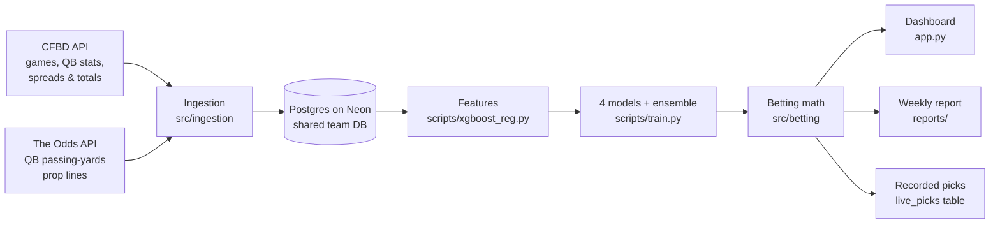

# Just Bet It

Just Bet It predicts how many passing yards a college quarterback will throw
for, compares that prediction to the sportsbook's over/under line, and flags
the games where the two disagree enough to bet. A weekly job collects new
games and lines, grades last weekend's picks, retrains the models and records
this week's picks before kickoff. A Streamlit dashboard shows the picks, the
best price across books, and how the models have done on real lines.

**Team:** Zach Burns (backend & systems), Vince Paino (machine learning),
Cody Shouse (data)
**Mentor:** Brooks Noonan

> **Not betting advice.** This is a student research project. Betting every
> game with these models loses money, and the one strategy that shows an
> edge has not been proven profitable yet (see [Results](#results)).

---

## Contents

- [The idea in one example](#the-idea-in-one-example)
- [How it works](#how-it-works)
- [Data](#data)
- [Features](#features)
- [Models](#models)
- [From prediction to pick](#from-prediction-to-pick)
- [The weekly cycle](#the-weekly-cycle)
- [How we evaluate (and avoid fooling ourselves)](#how-we-evaluate-and-avoid-fooling-ourselves)
- [Results](#results)
- [Dashboard](#dashboard)
- [Getting started](#getting-started)
- [Command reference](#command-reference)
- [Project layout](#project-layout)
- [Database](#database)
- [Limits and known issues](#limits-and-known-issues)

---

## The idea in one example

Week 10, 2026: a sportsbook set Ole Miss quarterback Trinidad Chambliss's
passing-yards line at **259.5** against Georgia.

| | Yards |
|---|---|
| Sportsbook line | 259.5 |
| Our XGBoost prediction | 242 |
| Actual | 170 |

The model was 17.5 yards under the line and all four models agreed on the
under, so it was a **confident pick: UNDER**, which won at −115.

A prop bet pays roughly even money on either side, and the book keeps a
small cut, so you need to win about **52.4%** of bets at −110 just to break
even. The whole project is about finding picks that clear that bar, and
being honest about whether they really do.

## How it works



1. **Ingest.** Pull FBS games, results and kickoff times, every QB's game
   stats and the books' game spreads and totals from CollegeFootballData
   (CFBD), plus QB passing-yards prop lines from The Odds API.
2. **Store.** Everything goes into one shared PostgreSQL database (Neon), so
   the whole team works from the same data.
3. **Build features.** For every QB-game, compute 20 features using only
   information from before kickoff.
4. **Predict.** Four models predict passing yards; their average is a fifth
   "ensemble" prediction.
5. **Decide.** Compare each prediction to every book's line, estimate the
   chance of winning, and pick the side and book with the best expected
   value.
6. **Track.** Record each week's picks before kickoff, check how the line
   moves, grade the results, and retrain.

## Data

| Source | What we take | Cost |
|---|---|---|
| [CollegeFootballData (CFBD)](https://collegefootballdata.com) | FBS games, scores, kickoff times; per-game QB passing and rushing stats; game spreads and over/unders from several books | Free tier, 1,000 requests a month (a normal week uses ~25) |
| [The Odds API](https://the-odds-api.com) | QB passing-yards prop lines with over/under prices from each book | 1 credit per game with props posted; free tier is 500 credits a month (a normal week uses ~35–60) |

As of November 2026 the database holds about **13,000 QB game logs**
(2022–present), **4,500 games**, **245 teams** and **12,400 prop lines**,
including 2,265 historical closing lines (2024–26) bought once on a paid
Odds API plan.

Some details that took real work to get right:

- **Game dates.** CFBD gives kickoff times in UTC, which would put every
  Saturday night game on Sunday. Games are stored on their U.S. game day
  (converted through Hawaii time, the westernmost U.S. zone), see
  [src/ingestion/dates.py](src/ingestion/dates.py).
- **Team names.** The Odds API says "Ole Miss Rebels", CFBD says "Ole Miss".
  [src/ingestion/team_names.py](src/ingestion/team_names.py) maps one to the
  other using CFBD's alternate names plus a short list of manual overrides.
- **Player names.** Books and CFBD don't always agree ("Tommy" vs.
  "Thomas" Castellanos). Players are matched by exact name among the two
  teams' QBs, then by last name only when exactly one QB has it.
- **Season year.** January bowl and playoff games belong to the previous
  season, so ingestion defaults to the season in progress, not the calendar
  year.

## Features

Every feature is known before kickoff. "Last N games" counts only the QB's
earlier games with 10+ pass attempts (so garbage-time appearances don't
count) and never includes the game being predicted. All of it is built in
[scripts/xgboost_reg.py](scripts/xgboost_reg.py), the one place training,
backtests, the dashboard and live picks get their features from.

| Group | Features |
|---|---|
| **QB recent form** | passing yards averaged over the last 3 games, last 5 games and the season so far; spread of the last 5 games; trend (last 3 minus season); number of earlier games |
| **QB efficiency & volume** | attempts, yards per attempt, completion % and rushing yards over the last 5 games; expected yards (YPA × attempts); his share of the team's attempts |
| **Team & opponent** | team pass attempts per game (last 5); passing yards the opponent's defense allowed per game (last 5) |
| **Game context** | home or away, days of rest (capped at 21), week |
| **Betting market** | the game's over/under, his team's spread, and the points the market expects his team to score (total ÷ 2 − spread ÷ 2), from CFBD's consensus game lines |

What XGBoost leans on most: season average (19% of importance), last-5
average (16%), last-3 average (13%), the market's implied team points (10%)
and expected yards (8%).

A QB needs at least 3 earlier games before the models will predict for him.

## Models

All five are trained by [scripts/train.py](scripts/train.py) on the same
features and saved together in `models/qb_models.pkl`.

| Model | Notes |
|---|---|
| Linear regression | Baseline |
| Random forest | 300 trees, depth 10 |
| **XGBoost** | The main model. Settings tuned with Optuna (time-series cross-validation), stored in [configs/xgboost_reg_params.json](configs/xgboost_reg_params.json) |
| Neural network | Small MLP (64 → 32), early stopping |
| Ensemble | Average of the four |

Linear regression, random forest and the neural network can't handle
missing values, so blanks (a QB's first game of a season, say) are filled
with the training median plus a "was missing" flag. XGBoost handles blanks
itself.

Training runs in two steps: first it scores every model on the newest 20%
of games (and saves those held-out misses for the win-probability math),
then it refits on all games for live predictions.

## From prediction to pick

The betting logic lives in [src/betting/](src/betting) (`odds.py`,
`probability.py`, `kelly.py`, `strategy.py`).

1. **Win probability.** A prediction of 242 yards against a 259.5 line
   isn't a certainty. `probability.py` turns it into P(over), P(under) and
   P(push) using the model's real misses on held-out games, so lopsided or
   fat-tailed errors are accounted for.
2. **Expected value.** EV = P(win) × payout − P(lose), per 1 unit staked, at
   each book's actual price.
3. **Line shopping.** Every book's line and price are checked and the
   side and book with the highest EV are recommended. Books in our data
   include FanDuel, BetMGM, BetRivers, Bovada and BetOnline (the last two
   are offshore, not state-licensed).
4. **Sizing.** Bets that clear the minimum EV (3% by default) get a quarter
   Kelly stake, capped at 5% of bankroll per bet and 30% across one day's
   bets.

### The confident-picks rule

Our main strategy, written down on **October 26, 2026**, before any game
it's judged on:

> Bet XGBoost's side only when it's **at least 15 yards from the line** and
> **all four models pick the same side**.

It's defined once (`CONFIDENT_RULE` in
[scripts/weekly_report.py](scripts/weekly_report.py)) and never edited; a
different rule would be registered under a new date.

## The weekly cycle

Two scheduled jobs (macOS launchd, installed by
`scripts/install_snapshot_schedule.sh`) run on one team member's Mac:

| When (Central) | Job | What it does |
|---|---|---|
| **Friday 9:00 am** | `scripts/snapshot_odds.sh` | Pull new CFBD games and stats, save prop lines for games in the next 48 hours, grade last weekend's picks into `reports/`, retrain the models, record this week's picks in `live_picks`, back up the database |
| **Fri 4 pm, Sat 10 am, 1 pm, 4 pm, 7 pm** | `scripts/snapshot_closing.sh` | Re-check the line shortly before kickoff for each confident pick (1 credit per game) to measure closing-line value |

Grading runs **before** retraining, so each week is graded by the model that
made its picks. Every step after ingestion retries up to 3 times if the
database connection drops, and the Odds API steps never spend below a
50-credit reserve or pay twice for the same game.

The Mac has to be **plugged in** Thursday night through Saturday: on battery
with the lid closed it only half-wakes and loses its network mid-job.

## How we evaluate (and avoid fooling ourselves)

A model scored on games it has already seen always looks better than it
is. These are the rules everything in [Results](#results) follows:

- **Walk-forward testing.** For every week of 2024–26 with real lines, all
  four models are retrained only on games played before that week, then
  scored on that week. Nothing is predicted with information from its own
  future.
- **Real closing lines and real prices.** Picks are graded against each
  book's last line before kickoff, at the price it actually offered.
- **Rules written before the test.** Every experiment's pass/fail rule is
  logged first, then the result, good or bad, in
  [reports/model_experiments.md](reports/model_experiments.md).
- **Clean settings.** The XGBoost settings were re-tuned using only games
  before 2024, so the seasons we report were never used to choose them.
- **Closing-line value (CLV).** Win/loss needs thousands of bets to mean
  anything. CLV asks a faster question: after we'd have bet on Friday, did
  the line move toward our side by kickoff? Sharp bettors consistently get
  positive CLV; it's the standard early sign of a real edge.
- **Corrected for multiple tries.** When several strategies are tested at
  once, each must pass a stricter bar (Bonferroni).

## Results

Walk-forward on **2,265 graded games** with real closing lines (2024–26):

| Strategy | Bets | Win rate | Units (1 per bet) | Verdict |
|---|---|---|---|---|
| XGBoost, every game | 2,265 | 51.2% | −90.4 | Loses |
| Ensemble, every game | 2,265 | 52.5% | −38.2 | Loses |
| **Confident picks** | 794 | **54.9%** | **+23.5** | Positive, not yet proven (p = 0.083) |

| Confident picks by season | Win rate | Units |
|---|---|---|
| 2024 | 56.1% | +15.5 |
| 2025 | 56.4% | +17.1 |
| 2026 (through week 9) | 50.8% | −9.1 |

**Closing-line value passes.** Lines moved toward our confident picks by
**+2.7 yards** on average between Friday and kickoff (moved our way 50% of
the time, against us 23%, p < 0.001). That's the strongest evidence the edge
is real.

**What this means:** the models can't beat the books on every game; the
sportsbook line is slightly more accurate than any of our models (60.6 vs.
61.5 yards average miss). But when all four models agree and disagree with
the line by a lot, there's a small, real edge. Whether it's big enough to
beat the books' cut is still open, which is why every live pick is now
recorded before kickoff and graded each week
([reports/weekly_results.md](reports/weekly_results.md)).

Things we tried that didn't clearly help (median target, opponent-adjusted
defense, pace, prior season, line movement, a line-aware model, line
shopping, bigger edge thresholds, an EV filter) are written up in
[reports/model_experiments.md](reports/model_experiments.md).

## Dashboard

```bash
streamlit run app.py
```

Opens at http://localhost:8501. Five tabs:

| Tab | What it shows |
|---|---|
| **This week** | Every QB with a line this week: our prediction vs. the consensus line, the recommended side, book and price, EV and stake. A "compare sportsbooks" table shows every book's line and EV |
| **Confident picks** | Only the picks that meet the rule, plus the rule's record by season, a running-profit chart and the live record |
| **QB lookup** | Pick any quarterback: his recent games with the line and our out-of-sample prediction for each, and all five models' prediction for any game on his schedule |
| **Backtest** | Every model on the 2,265 past games, filterable by season, with running profit and a Kelly bankroll simulation |
| **Models & data** | When the models were trained, feature importance, database row counts, recent ingestion runs, and a retrain button |

The Backtest tab, the track record and the QB lookup's past predictions use
the walk-forward predictions cached in
`data/raw/walkforward_preds_pre2024.csv`. That file is gitignored, so build
it once (a few minutes):

```bash
python -m scripts.vs_closing_lines --params configs/xgboost_reg_params_pre2024.json --cache data/raw/walkforward_preds_pre2024.csv
```

## Getting started

Full step-by-step setup, including the shared database and common errors,
is in [TEAMMATE_SETUP.md](TEAMMATE_SETUP.md). The short version:

```bash
git clone <repo-url> && cd Just-Bet-It
python3 -m venv .venv && source .venv/bin/activate
pip install -r requirements.txt   # XGBoost on macOS also needs: brew install libomp
cp src/.env.example .env           # then fill in the values below
python -m scripts.train            # trained models aren't in git
streamlit run app.py
```

`.env` needs:

| Variable | Who needs it |
|---|---|
| `DATABASE_URL` | Everyone: the shared Neon connection string (ask Cody) |
| `CFBD_API_KEY` | Anyone running ingestion (free at collegefootballdata.com) |
| `ODDS_API_KEY` | Only whoever runs the weekly props job; never share a key |

Never commit `.env`. On the shared database the tables already exist; for
a local Postgres, create them with `psql -d just_bet_it -f src/db/schema.sql`.

## Command reference

Run everything from the project root with the virtual environment active.

| Command | What it does | API cost |
|---|---|---|
| `python -m src.ingestion.run_ingestion` | Pull CFBD games, game lines and QB stats for the current season | ~25 CFBD requests |
| `python -m src.ingestion.run_ingestion --props` | ...plus QB prop lines for games in the next 24h | 1 Odds credit per game |
| `python -m scripts.train` | Score all models on held-out games, then refit on everything | none |
| `python -m scripts.predict_upcoming` | This week's predictions vs. stored lines, with EV and stakes | none |
| `python -m scripts.predict --qb-id <id> --game-date YYYY-MM-DD` | One QB, one game, every model | none |
| `python -m scripts.record_picks` | Record this week's picks in `live_picks` | none |
| `python -m scripts.weekly_report` | Grade new games into `reports/` | none |
| `python -m scripts.backtest` | Score the saved models on graded games after their training cutoff | none |
| `python -m scripts.vs_closing_lines` | The walk-forward test against 2,265 closing lines | none |
| `python -m scripts.clv` | Closing-line value of the walk-forward picks | none |
| `python -m scripts.snapshot_closing` | Near-kickoff line check for confident picks | 1 Odds credit per game |
| `python scripts/xgboost_reg_tune.py` | Re-tune XGBoost with Optuna (`--before DATE` to tune on earlier games only) | none |
| `python -m scripts.backup_db` | `pg_dump` the database to `data/raw/backups/` (last 8 kept) | none |
| `python -m pytest` | Run the test suite (59 tests) | none |
| `scripts/install_snapshot_schedule.sh` | Install both weekly jobs on this Mac (`--remove` to uninstall). Only one machine should have them | — |

## Project layout

```
app.py                      Streamlit dashboard
src/
  ingestion/
    run_ingestion.py        entry point: games, lines, QB stats, props
    cfbd_ingest.py          CFBD fetching and cleaning
    odds_api.py             The Odds API client (retries, credit tracking)
    team_names.py           Odds API → CFBD team name matching
    dates.py                kickoff → U.S. game day, current season
  betting/                  odds math, win probability, EV, Kelly, line shopping
  db/
    schema.sql              table definitions
    models.py               SQLAlchemy models
    session.py              database connection (reads .env)
scripts/
  xgboost_reg.py            data loading + all feature engineering
  train.py                  train and save every model
  predict.py, predict_upcoming.py, record_picks.py
  weekly_report.py          grading, confident-picks record, live CLV
  backtest.py, vs_closing_lines.py, clv.py, compare_features.py
  snapshot_odds.sh          Friday 9am job
  snapshot_closing.sh       near-kickoff line checks
  install_snapshot_schedule.sh
  backfill_props.py         one-time historical line purchase (paid plan)
  backup_db.py, merge_odds_teams.py, xgboost_reg_tune.py
configs/                    tuned XGBoost settings (all data, and pre-2024 only)
reports/
  weekly_results.md         week-by-week record (generated)
  graded_picks.csv          every graded pick, append-only (generated)
  model_experiments.md      every experiment, its rule and its result
tests/                      pytest suite
data/                       backups and caches (gitignored)
models/                     trained models (gitignored)
```

## Database

PostgreSQL, shared on Neon. Schema in
[src/db/schema.sql](src/db/schema.sql), SQLAlchemy models in
[src/db/models.py](src/db/models.py); missing tables are created
automatically when ingestion runs.

| Table | Holds |
|---|---|
| `teams` | One row per school (CFBD names) |
| `games` | Every FBS game: teams, date, kickoff time, season, week, score |
| `game_lines` | CFBD spreads, over/unders and moneylines per game per book |
| `qb_game_stats` | One row per QB per game: passing and rushing stats |
| `qb_prop_lines` | Every prop line snapshot: book, line, over/under prices, time fetched |
| `live_picks` | Each week's picks as recorded before kickoff (written once, never changed) |
| `qb_prop_closing_lines` | Near-kickoff line checks for confident picks (for live CLV) |
| `odds` | Game moneyline/spread/total snapshots from The Odds API |
| `ingestion_log` | Every ingestion run and whether it succeeded |

`features`, `qb_game_features`, `users` and `user_predictions` are from the
original design and are currently unused. `team_game_stats` (team box
scores) is filled by the experiments branch and isn't used on `main`.

## Limits and known issues

- **Profit isn't proven.** 794 confident picks at 54.9% is encouraging but
  could still be luck (p = 0.083). It needs more live weeks.
- **Only Friday and Saturday games.** To save credits, lines are captured
  once on Friday for the next 48 hours, so weeknight games are skipped.
- **Few books.** The free Odds API region returns a handful of books for
  college props, two of them offshore.
- **Runs on a laptop.** The weekly jobs need one Mac awake and plugged in;
  a cloud scheduler would be sturdier.
- **What the models can't see.** Injuries, weather and game plans aren't in
  the data. The betting line partly captures them, which is why the market
  features help.
